# Stipendi dei Docenti in Italia e in Europa (2000–2025)
### Analisi longitudinale del potere d'acquisto reale, microsimulazione fiscale e confronto europeo

Questo progetto analizza l'evoluzione delle retribuzioni dei docenti della scuola secondaria di II grado in Italia dal **2000 al 2025**, scomponendo l'erosione del potere d'acquisto tra **dinamica contrattuale/inflazione** ed **effetto fiscale**, e confrontando il posizionamento italiano con i principali partner europei (**Francia, Germania, Belgio, Spagna, Polonia, Grecia** e **Media OCSE**).

---

## Principali evidenze (Executive Summary)

1. **L'erosione contrattuale ha colpito in modo uniforme tutte le fasce (-6,5% / -8,0% reale):** tra il 2000 e il 2025 i salari lordi tabellari italiani, deflazionati con l'indice HICP Eurostat a prezzi costanti 2025, hanno perso tra il **6,4%** e l'**8,0%** di potere d'acquisto (e circa il **13%–14%** rispetto al picco reale del 2007).
2. **Lo sdoppiamento fiscale in Italia (Effetto Contratto vs Effetto Fisco):**
   * Sui **neoassunti (fascia 0–8)** le riforme IRPEF, le detrazioni e il taglio del cuneo hanno restituito **+7,2%** di potere d'acquisto, compensando quasi integralmente la perdita contrattuale (**+0,1%** netto reale complessivo).
   * Sulle **fasce senior (28–34 e 35+)** il *fiscal drag* ha invece amplificato la perdita contrattuale di un ulteriore **-1,6% / -1,7%**, portando il calo del netto reale a **-8,0% / -8,5%**.
3. **La "trappola della progressività" in Europa:** nel 2025 l'Italia presenta il salto di aliquota effettiva più ripido tra tutti i paesi analizzati passando dal 67% al 167% del salario medio nazionale (**+20,7 punti percentuali**, dal 19,1% al 39,9%), più del doppio rispetto alla Media OCSE (**+9,6 p.p.**) e alla Francia (**+10,1 p.p.**).
4. **Il ritardo europeo è strutturalmente un problema di salari lordi:** sul lavoratore medio (`100% AW`), la pressione fiscale effettiva italiana nel 2025 (**28,6%**) è sostanzialmente in linea con il 2000 (**29,0%**, `-0,4 p.p.`) e con la Francia (**28,0%**), e ben inferiore a Germania (**38,7%**) e Belgio (**39,5%**). Il divario italiano nel confronto europeo dipende quindi primariamente dalla stagnazione dei salari lordi contrattuali, aggravata dalla ripidità fiscale sulle progressioni di carriera.

---

## Risultati e visualizzazioni complete

### Parte 1 — Italia: salari lordi reali e progressione di carriera (2000–2025)

**1.1 Evoluzione del salario lordo reale per fascia fissa (prezzi costanti 2025)**
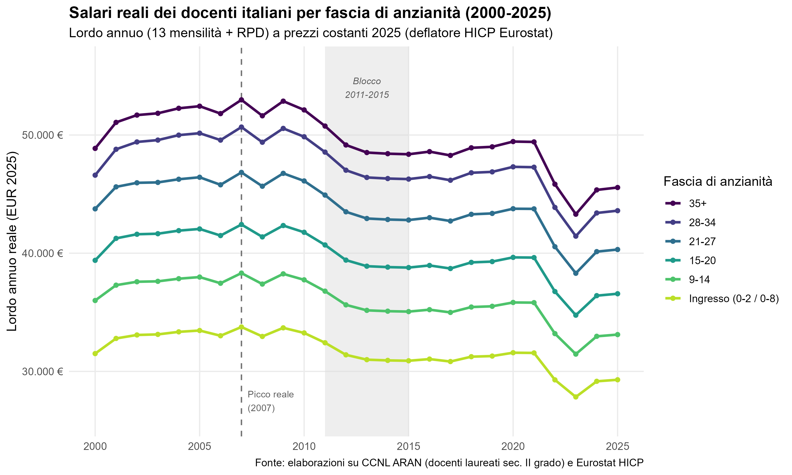

**1.2 Traiettoria reale della coorte assunta nel 2000 (0 → 25 anni di anzianità)**
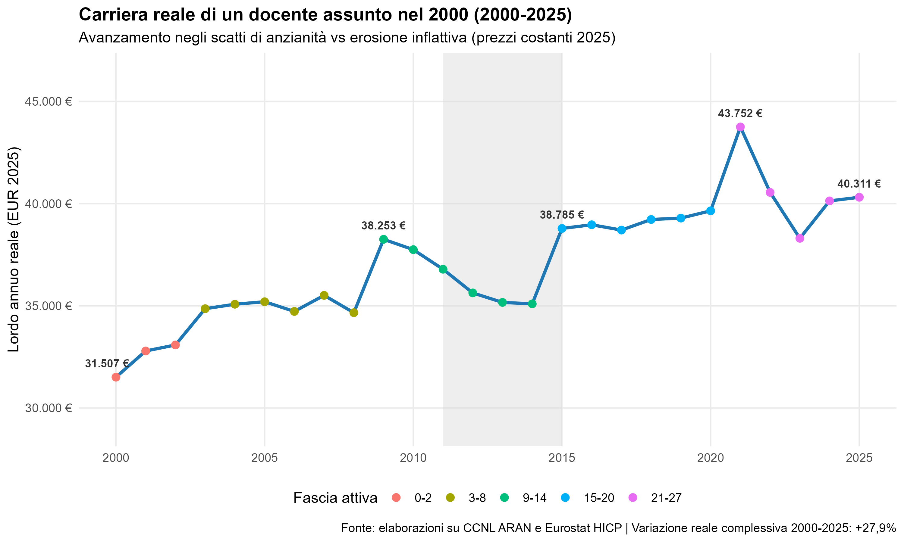

---

### Parte 2 — Italia: microsimulazione fiscale, salari netti e scomposizione (2000–2025)

| Fascia di anzianità | Effetto Contratto / Inflazione (Lordo reale) | Effetto Fisco (Riforme vs Fiscal Drag) | Variazione Netto Reale Totale |
| :--- | :---: | :---: | :---: |
| **Ingresso (0–2 / 0–8)** | -7,0% | +7,2% | **+0,1%** |
| **9–14** | -8,0% | +5,7% | **-2,3%** |
| **15–20** | -7,2% | +4,0% | **-3,2%** |
| **21–27** | -7,9% | +0,9% | **-7,0%** |
| **28–34** | -6,5% | -1,6% | **-8,0%** |
| **35+** | -6,8% | -1,7% | **-8,5%** |

**2.1 Salario netto reale annuo per fascia di anzianità (2000–2025)**
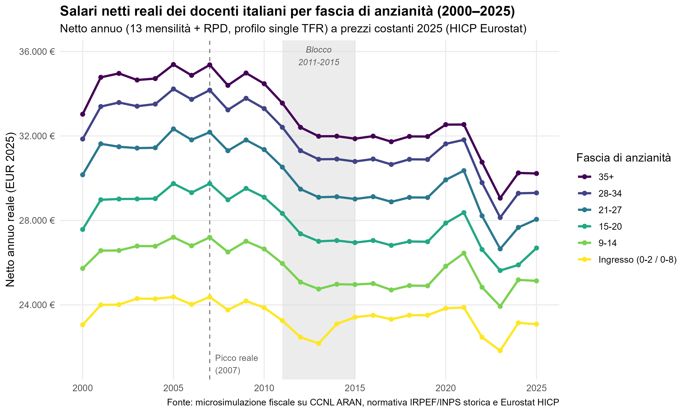

**2.2 Salario netto reale mensile su 13 mensilità (2000–2025)**
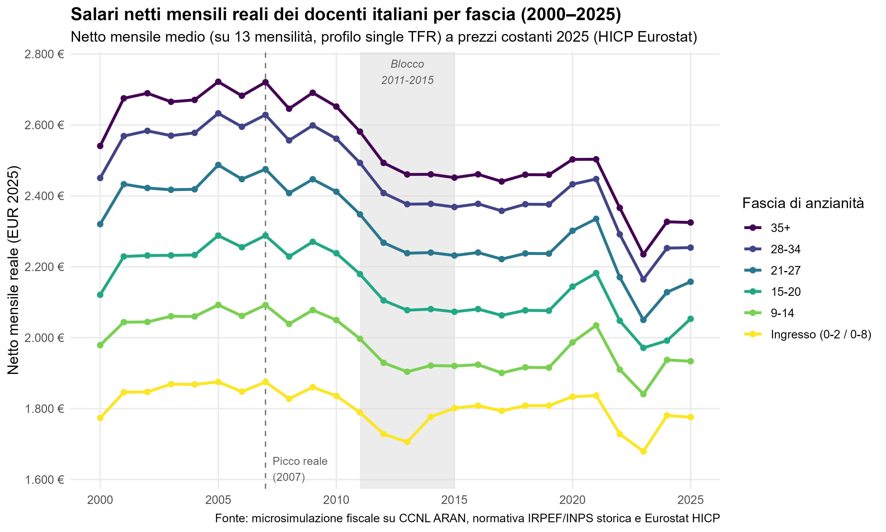

**2.3 Evoluzione della pressione fiscale effettiva in Italia per fascia (2000–2025)**
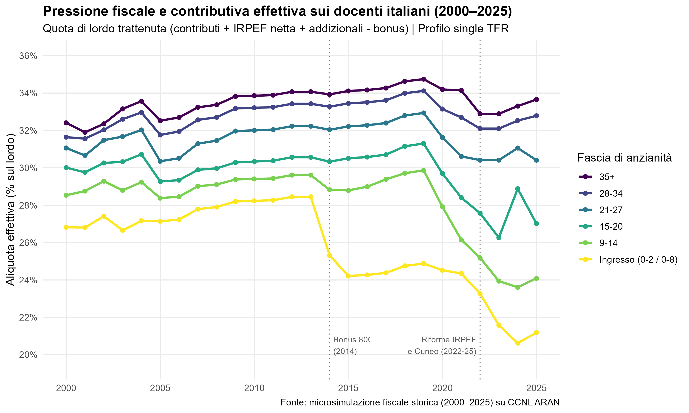

**2.4 Scomposizione della variazione reale (2000–2025): Effetto Contratto vs Effetto Fisco**
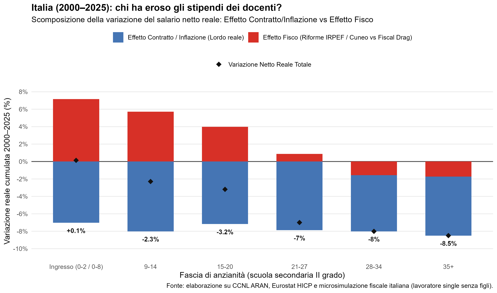

---

### Parte 3 — Confronto europeo: salari lordi, netti, fisco e progressività

**3.1 Salari statutari lordi in parità di potere d'acquisto (USD PPP, 2025)**
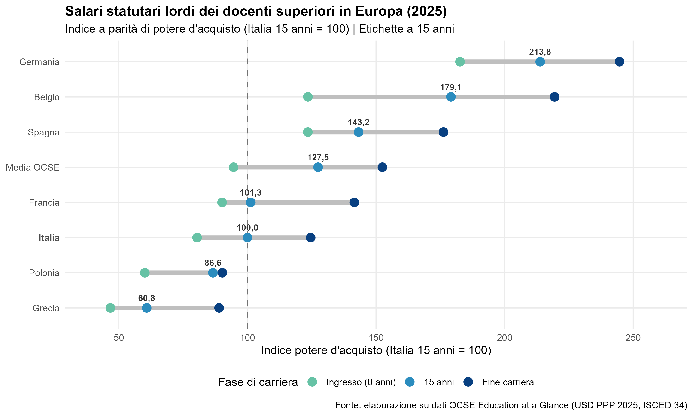

**3.2 Evoluzione reale dei salari docenti in Europa (2015–2025)**
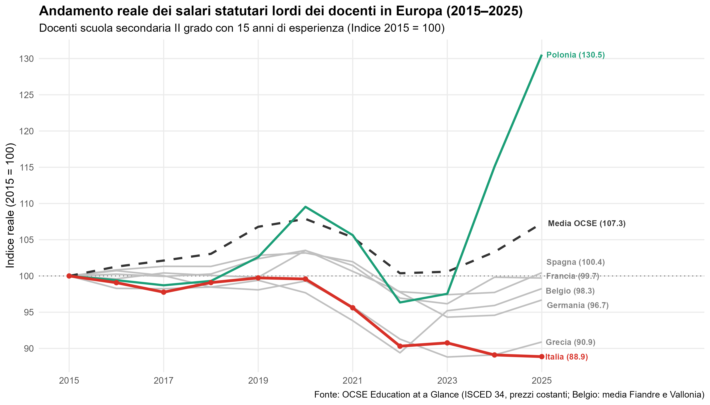

**3.3 Confronto europeo Lordo vs Netto a 15 anni di esperienza (2025, Italia = 100)**
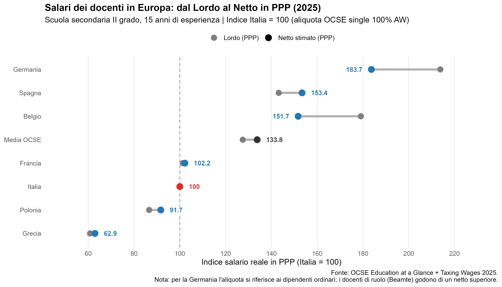

**3.4 Evoluzione della pressione fiscale effettiva in Europa (2000–2025, 100% AW)**
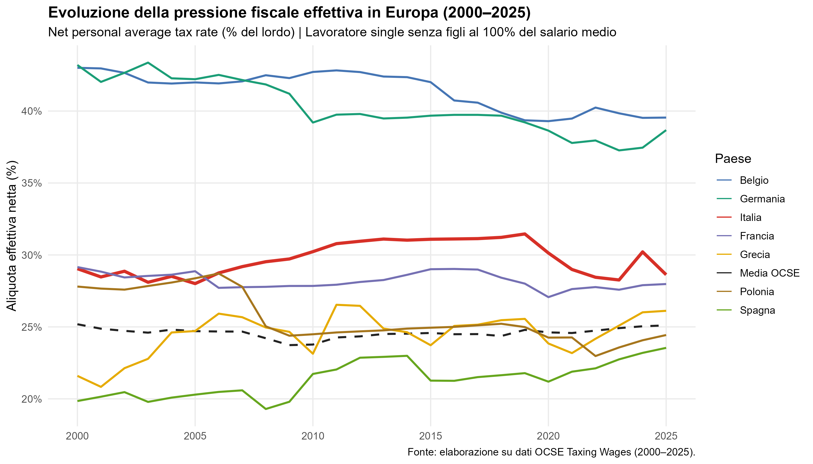

**3.5 La trappola della progressività fiscale in Europa (2025: 67% vs 100% vs 167% AW)**
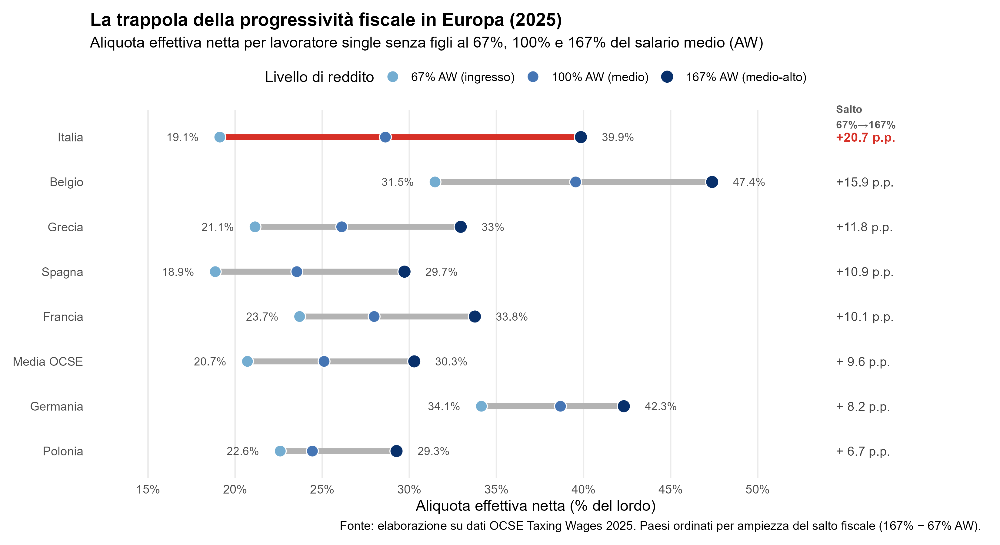

---

## Fonti dati e metodologia

* **Retribuzioni italiane (2000–2025):** Serie storica costruita sui **CCNL Comparto Scuola (ARAN)** per docenti di scuola secondaria di II grado (stipendio tabellare su 13 mensilità + Retribuzione Professionale Docenti).
* **Inflazione:** Indice armonizzato dei prezzi al consumo (**Eurostat HICP**, dataset `prc_hicp_aind`, voce `CP00`), utilizzato per deflazionare le serie a prezzi costanti 2025.
* **Confronto internazionale e fisco:** Dataset **OCSE *Education at a Glance*** (salari statutari in USD PPP e indici reali 2015–2025) e **OCSE *Taxing Wages*** (2000–2025, *Net personal average tax rate* per lavoratore single senza figli al 67%, 100% e 167% del salario medio nazionale).
* **Microsimulazione fiscale italiana:** Modello ad alta accuratezza implementato in R (`04_simulazione_netto_italia.R`) che replica scaglioni e aliquote IRPEF storiche (2000–2025), contributi previdenziali a carico dipendente, detrazioni lavoro dipendente, bonus/taglio del cuneo e addizionali locali medie per un profilo standard (*single senza carichi familiari, regime TFR*).

### Limiti e cautele metodologiche
* La microsimulazione italiana e i benchmark OCSE *Taxing Wages* si riferiscono a un **lavoratore single senza figli**; carichi familiari, detrazioni per spese personali e addizionali regionali/comunali specifiche possono modificare l'aliquota effettiva individuale.
* Il confronto europeo utilizza i salari statutari OCSE in PPP: in alcuni paesi (es. Germania per i docenti di ruolo *Beamte*) vigono regimi contributivi speciali non interamente catturati dall'aliquota media del lavoratore dipendente standard.

---

## Struttura della repository

```text
stipendi-docenti-ita-eu/
├── 01_data_raw/           # Dataset grezzi (Eurostat HICP, OCSE EAG e Taxing Wages)
├── 02_data_clean/         # Dataset puliti, uniti e pronti per l'analisi
├── 03_scripts/
│   ├── 01_download_api.R              # Download automatico HICP da API Eurostat
│   ├── 02_clean_and_merge.R           # Pulizia CCNL ARAN, deflazione e pulizia dataset OCSE
│   ├── 03_analysis_plots.R            # Analisi longitudinale Italia (lordo) e confronti PPP/trend EU
│   ├── 04_simulazione_netto_italia.R  # Microsimulazione fiscale 2000-2025 e scomposizione Contratto vs Fisco
│   └── 05_confronto_netto_europa.R    # Confronto netto europeo, pressione fiscale e progressività
├── 04_output/             # Tutti gli 11 grafici finali (.png, 300 dpi)
├── 05_report/             # Working Paper accademico (.tex e .pdf)
├── .gitignore
├── README.md
└── stipendi-docenti-ita-eu.Rproj